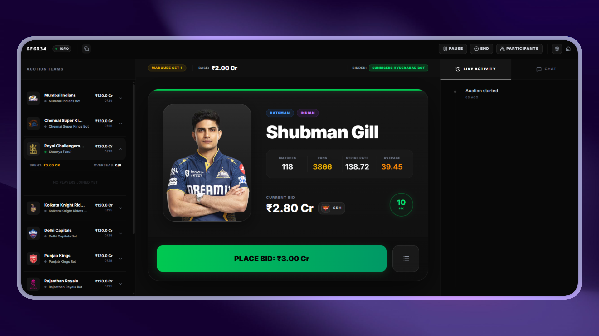

<div align="center">

  # Crick Auction
  ### *The ultimate real-time SaaS auction, live multiplayer bidding, and AI squad evaluation engine.*

  [](https://reactjs.org/)
  [](https://vitejs.dev/)
  [](https://tailwindcss.com/)
  [](https://firebase.google.com/)
  [](https://workers.cloudflare.com/)
  [](https://groq.com/)

  Host live multiplayer auctions with friends, manage budgets, and bid in real time.<br />
  Play 100% device-local Solo vs. 9 autonomous AI bot franchises with zero server latency.<br />
  Evaluate drafted squads with Groq-powered AI Scout Ratings (0–100) and format-specific tactical verdicts.<br />
  Sub-second bidding backed by a 7-server Firebase RTDB cluster and Cloudflare D1 edge database.

  [Play Now](https://crickauction.in) • [Documentation](#documentation) • [Releases](#recent-feature-releases-november-2026) • [Contributing](#develop-and-contribute)
  <br />
  <br />
</div>

<p align="center">
  
</p>

## A Platform for Competitive Cricket Auctions

One host can run an auction room, but running a competitive multiplayer auction across 10 friends creates a complex synchronization challenge: synchronized bid countdowns, real-time purse calculations, overseas player quotas, squad limits, and sub-second latency.

**Crick Auction** is built for that challenge. Create a private lobby with friends or play Solo against autonomous bots. For every player that comes under the hammer, universal clock-drift synchronization guarantees fair bidding across all devices.

---

## Recent Feature Releases (November 2026)

###  1. AI Squad Ratings & Scout Analysis (0–100)
- **Deep Squad Evaluation**: Evaluates entire franchise rosters using Groq LLM (`qwen/qwen3.8-27b`) to score team strength (0–100), assign letter grades (`A+`, `A`, `B`, etc.), and generate tactical 1–2 line squad reviews.
- **AI Scout Winner**: Crowns the standout franchise with a tournament favorite title and verdict.
- **Format-Specific Intelligence**:
  - **Mega Auction**: Starting XI excellence, bowling variety, bench depth, and overseas balance.
  - **11-Classic**: Exact playing XI balance without bench (solid top order, wicketkeeper, 5+ bowling options).
  - **5-Sprint**: Explosive hitters, death bowling specialists, and high individual impact.
- **Token-Friendly Disqualification**: Incomplete squads (< minimum required players) are automatically disqualified and excluded from AI prompts to save tokens and prevent invalid winner crowns.
- **Host-Exclusive Controls**: Only the room creator/host can generate or re-analyze ratings. Non-hosts see an informative pending notice until generated.
- **Spam & Cost Protection**: 60-second room-level cooldown lock stored in Cloudflare D1, client-side countdown timer, and IP rate limiting.

###  2. Cloudflare D1 Edge Architecture & API
- **Migrated from Supabase to Cloudflare D1**: Public room directories, completed room records, and user team histories now live on Cloudflare's SQLite edge database.
- **Zero-Scan Platform Stats**: Atomic single-row `platform_stats` table replaces heavy `COUNT(*)` database scans.
- **Edge Caching**: Multi-tier HTTP caching (`s-maxage`, `stale-while-revalidate`) on `/api/public-rooms` and `/api/stats` to protect free tiers.
- **Security & Integrity**: Origin restriction, client header checks, and IP rate limiting (40 writes / 60 reads per min).

###  3. 100% Device-Local Solo vs. Bots Mode
- **Zero Socket Latency**: Run full solo auctions against 9 AI franchises locally in your browser memory and `localStorage` with zero Firebase RTDB socket connections.
- **Smart Bot Logic**: Autonomous bots bid with role targets, budget awareness, bid pacing, and marquee player valuations.
- **Fast-Forward & Pass Simulation**: Skip unwanted lots directly to bots or simulate remaining rounds instantly.
- **Two-Tab Lease Lock**: Web Locks API and BroadcastChannel prevent duplicate tabs from corrupting local state.
- **Automatic Cloud Sync**: Completed solo auctions automatically sync to Cloudflare D1 for public shareable summaries and poster exports.

###  4. 7-Server Dynamic RTDB Cluster
- **Horizontal Scaling**: Multi-server RTDB cluster (`server-1` through `server-7`) distributes rooms to eliminate free-tier socket exhaustion.
- **Live Server Switcher**: Dropdown selector displays server status, latency, and active room counts with automated failover routing.

###  5. Auction Room UX & Polish
- **Multiplayer Pass Consensus**: Skip unsold lots early with unanimous pass consent from all human managers (with highest-bidder protection).
- **High-Resolution Poster Export**: Generate 2x crisp PNG squad posters for social sharing with Web Share API and download fallback.
- **Monochrome Glassmorphic Theme**: Dark high-contrast styling (`#050505` page background, `#0c0d10` cards, `font-pixel` typography) aligned with `THEME.md`.

---

## How It Works

### 1. Public Directory & Edge Indexing
When you open Crick Auction, the app queries the **Cloudflare D1 edge directory** to load active public lobbies and platform statistics instantly without burdening the live bidding cluster.

### 2. Isolated Auction Nodes
Creating a multiplayer room provisions an isolated node on the selected **Firebase RTDB** cluster. Creating a solo room spins up an entirely local, in-memory auction engine with zero server dependency.

### 3. Claim Franchises & Autonomous AI Bots
Claim your franchise (CSK, MI, RCB, KKR, etc.) or fill empty slots with autonomous AI bots. Bots feature adaptive bidding personas—some bid aggressively early on, while others snipe in the final seconds!

### 4. The Live Bidding War
Every connected bidder sees the exact same timer and bid amount simultaneously, powered by a universal clock offset algorithm. Managers can bid, pass, track purses, and monitor overseas player quotas in real time.

### 5. Final Squads & AI Squad Evaluation
When the auction completes, squad snapshots are persisted to **Cloudflare D1**. Managers can inspect complete squads, generate social posters, and the host can trigger the **AI Scout** to evaluate franchise strength and crown the auction winner.

---

## Install & Run Locally

1. **Clone the repository**
   ```bash
   git clone https://github.com/Shaurya01836/ipl-auction.git
   cd ipl-auction
   npm install
   ```

2. **Configure Environment Variables**
   Create a `.env` file in the root directory:
   ```env
   # Firebase RTDB Multi-Server Cluster
   VITE_FIREBASE_API_KEY=your_firebase_api_key
   VITE_FIREBASE_AUTH_DOMAIN=your_project.firebaseapp.com
   VITE_FIREBASE_DATABASE_URL=https://your_project-default-rtdb.firebaseio.com
   VITE_FIREBASE_PROJECT_ID=your_project_id

   # Cloudflare Directory API (D1 & Edge Worker)
   VITE_DIRECTORY_API_URL=https://crickauction-api.crickauction.workers.dev
   ```

3. **Start local development server**
   ```bash
   npm run dev
   ```

4. **Run test suite**
   ```bash
   npm test
   ```

---

## Supported Tech Stack

| Layer | Technologies |
|---|---|
| **Core Frontend** | React 19, Vite 6, React Router 7 |
| **Styling & Motion** | Tailwind CSS v4, Framer Motion, Lucide Icons |
| **Live Bidding Engine** | Firebase RTDB (7-Server Cluster), BroadcastChannel, Web Locks API |
| **Directory & Storage** | Cloudflare Workers, Cloudflare D1 (SQLite), LocalStorage / SessionStorage |
| **AI Evaluation Engine** | Groq Cloud API (`qwen/qwen3.8-27b`), Strict JSON Schema Validation |
| **Export & Sharing** | html-to-image, canvas-confetti, Web Share API |

---

## License
Crick Auction is available under the [Apache License 2.0](LICENSE).
